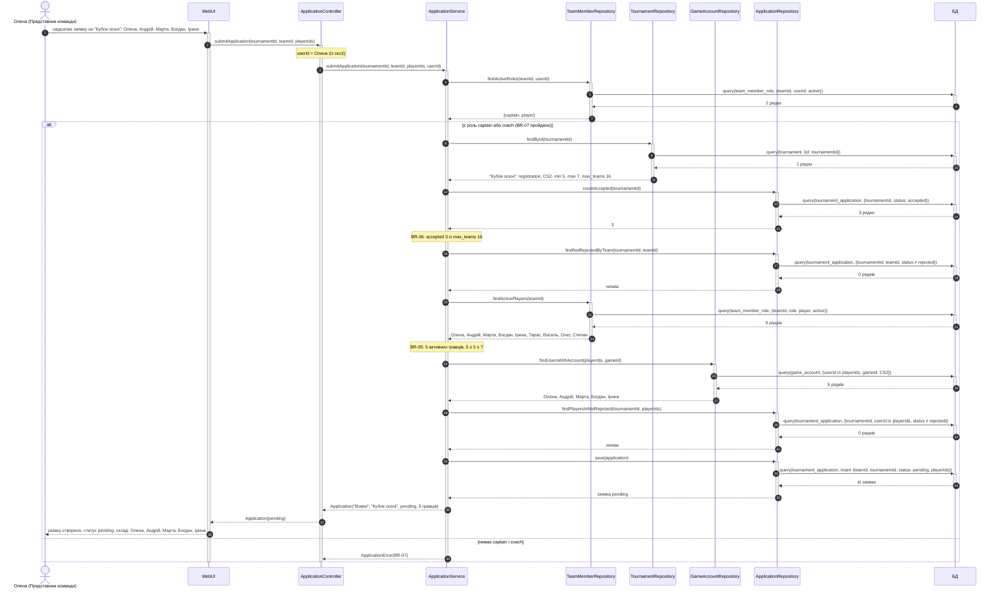

# S-01 - Представник команди подає заявку з допустимим складом

- Gherkin: `@S-01`, успішний шлях; BR-01…BR-07 пройдено.
- Фрагменти: `alt` на BR-07.
- Порядок перевірок: BR-07 -> BR-04 -> BR-06 -> BR-01 -> BR-05 -> BR-03 -> BR-02 -> save (ADR 0012).

