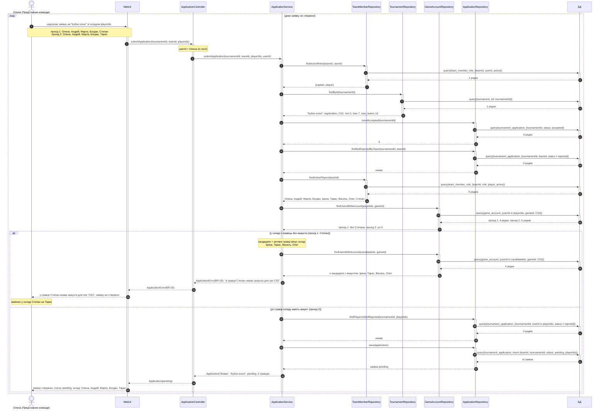

# S-02 - Представник команди замінює гравця без ігрового акаунта

- Gherkin: `@S-02`, альтернативний шлях; BR-03.
- Фрагменти: `loop [доки заявку не створено]` на повторне надсилання заявки, у ньому `alt` на BR-03.
- Прохід 1: склад Олена, Андрій, Марта, Богдан, Степан -> помилка BR-03. Прохід 2: Степана замінено на Тараса -> save, pending.

