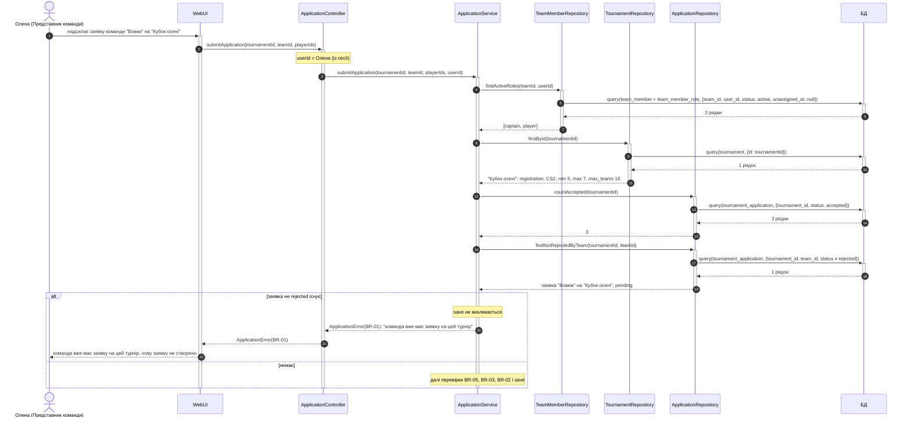

# S-03 - Команда вже має заявку на розгляді

- Gherkin: `@S-03`, помилковий шлях; BR-01.
- Фрагменти: `alt` на BR-01.
- BR-07, BR-04, BR-06 пройдено; на BR-01 - помилка, BR-05, BR-03, BR-02 і save не виконуються.

