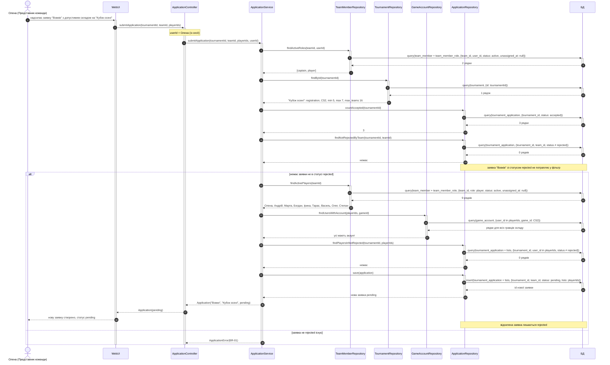

# S-04 - Після відхилення команда подає нову заявку

- Gherkin: `@S-04`, успішний шлях; BR-01.
- Фрагменти: `alt` на BR-01.
- Склад у Gherkin не названо - "допустимий склад" без імен (критерій 7).
- Заявка "Вовків" зі статусом rejected запитом `findNotRejectedByTeam` не враховується; викликів, що змінюють її, немає.

