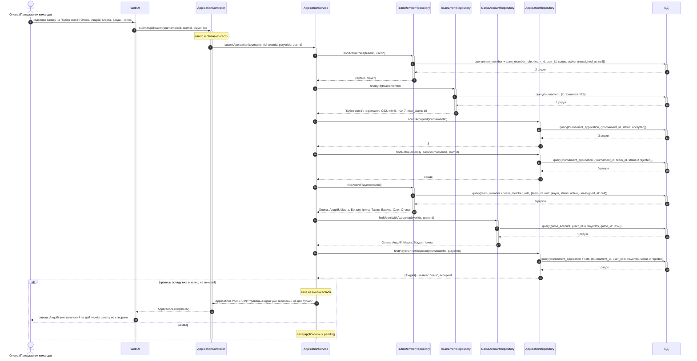

# S-05 - Гравець складу вже заявлений за іншу команду

- Gherkin: `@S-05`, помилковий шлях; BR-02.
- Фрагменти: `alt` на BR-02.
- Усі перевірки до BR-02 пройдено; Андрій входить до складу заявки "Левів" (accepted).

