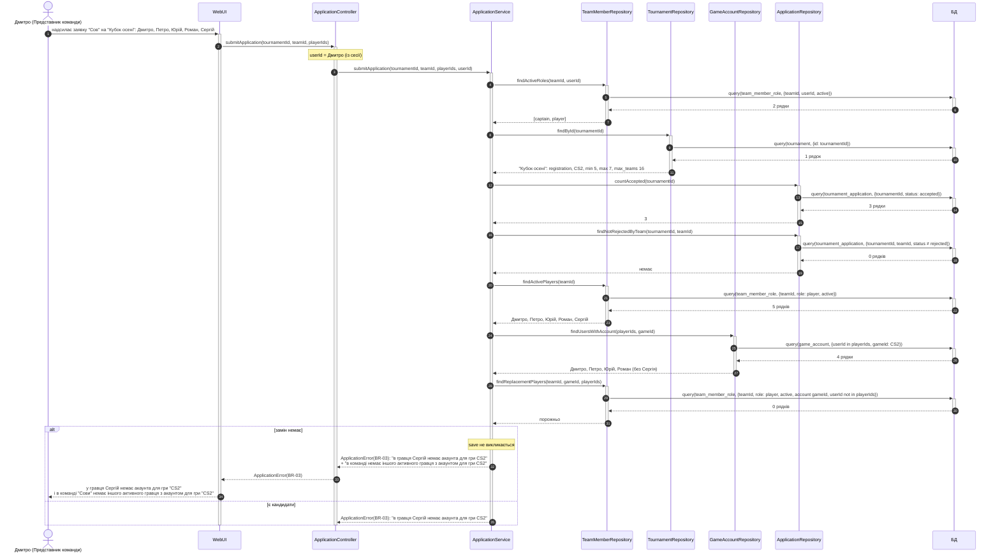

# S-06 - У команді немає гравця з акаунтом для заміни

- Gherkin: `@S-06`, помилковий шлях; BR-03.
- Фрагменти: `alt` на результаті пошуку заміни.
- Команда "Сови", Дмитро (captain, player). Сергій без акаунта CS2; інших активних гравців з акаунтом поза складом немає.

