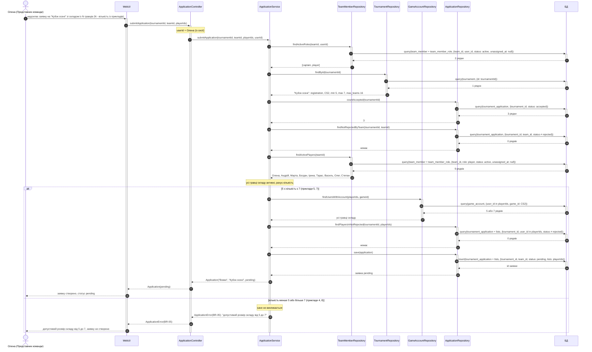

# S-08 - Кількість гравців у складі

- Gherkin: `@S-08`, структура сценарію; BR-05. Приклади: 4, 5, 7, 8.
- Фрагменти: `alt` на BR-05; обидві гілки належать цьому сценарію, тому обидві повні.
- До складу обрано `<кількість>` активних гравців "Вовків" з акаунтом CS2 (Олена, Андрій, Марта, Богдан, Ірина, Тарас, Василь, Олег).

