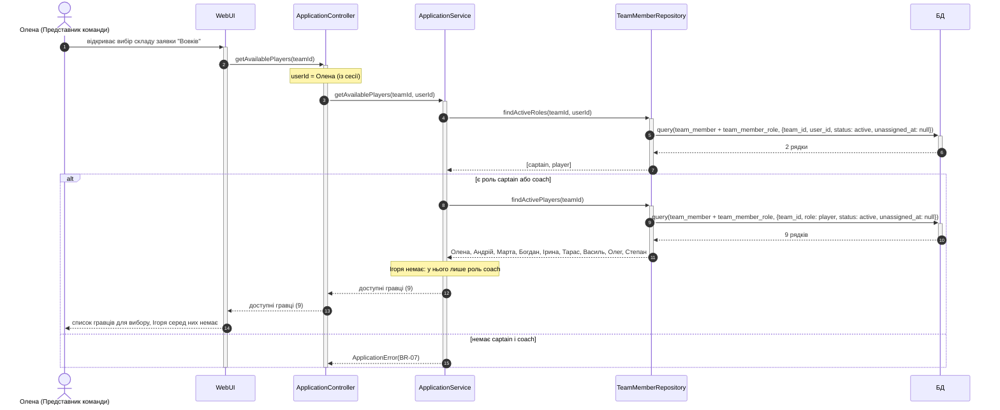

# S-09 - Тренер без ролі player не входить до складу

- Gherkin: `@S-09`, успішний шлях; BR-05 (і BR-07 для доступу до вибору складу).
- Фрагменти: `alt` на BR-07.
- Інший виклик: вибір складу (`getAvailablePlayers`), заявка не створюється. Ігор у "Вовках" лише з роллю coach.

