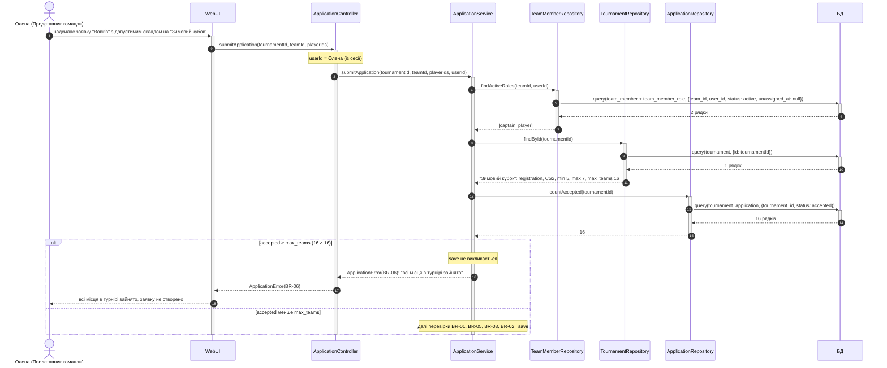

# S-10 - Усі місця в турнірі зайнято

- Gherkin: `@S-10`, помилковий шлях; BR-06.
- Фрагменти: `alt` на BR-06.
- Турнір "Зимовий кубок": registration, max_teams 16, accepted 16. BR-07 і BR-04 пройдено.

