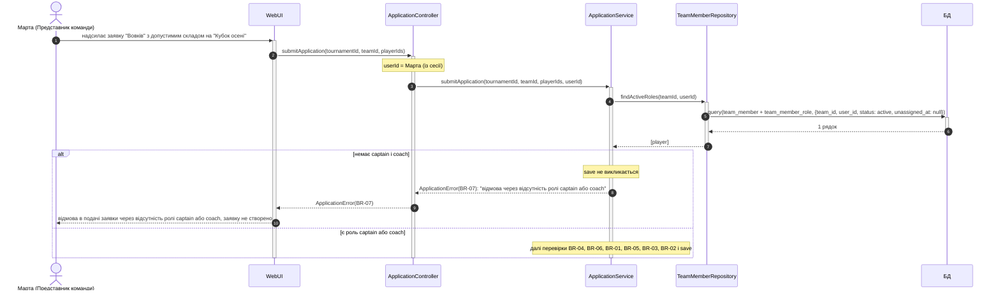

# S-11 - Заявку надсилає учасник без ролі captain або coach

- Gherkin: `@S-11`, помилковий шлях; BR-07.
- Фрагменти: `alt` на BR-07.
- Марта в "Вовках" лише з роллю player. BR-07 - перша перевірка, інших викликів немає.

