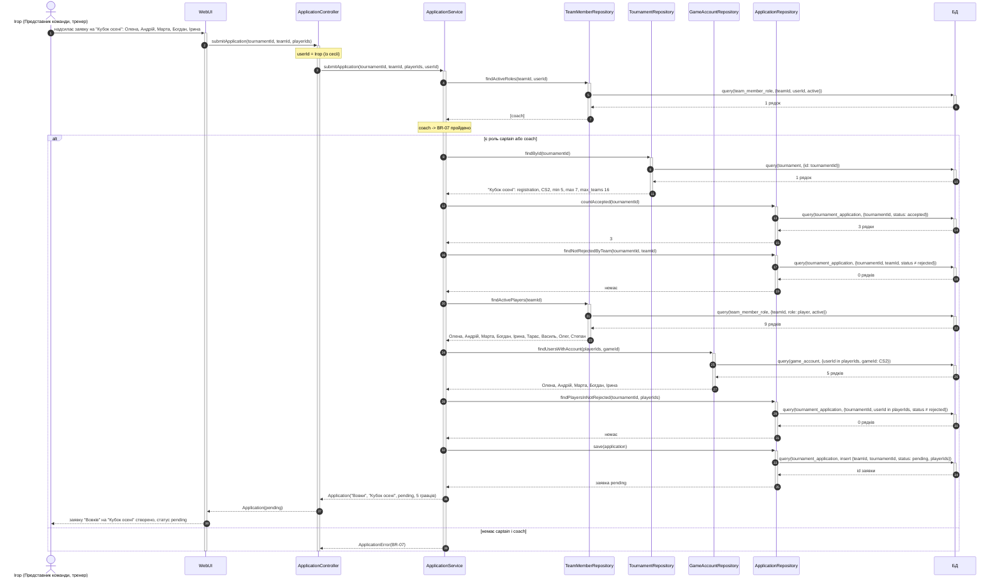

# S-12 - Тренер подає заявку

- Gherkin: `@S-12`, успішний шлях; BR-07.
- Фрагменти: `alt` на BR-07 з `note` "coach -> BR-07 пройдено".
- Ігор у "Вовках" з роллю coach (без player); склад Олена, Андрій, Марта, Богдан, Ірина.

